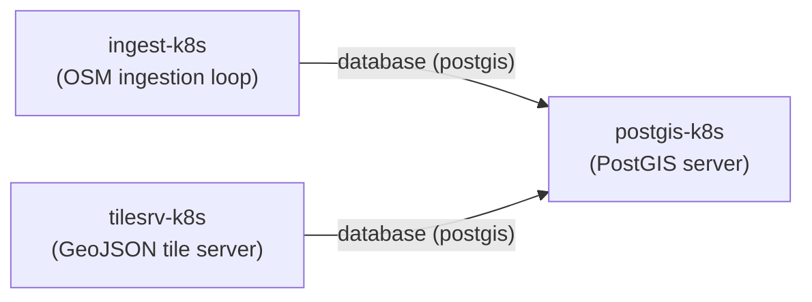

# Soundscape data-pipeline Juju charms

This directory is a Juju translation of [`svcs/data/docker-compose.yml`](../docker-compose.yml).
It splits the compose file's three main services into three Kubernetes charms
that are related to each other the same way the compose services depend on
one another. The blue/green `tilesrv` rollout scheme from the compose file is
intentionally not represented — only a single tile-server deployment is
modeled here.

| Charm            | Compose service equivalent | Image source                     |
|-------------------|----------------------------|-----------------------------------|
| `postgis-k8s`      | `postgis`                  | `docker.io/postgis/postgis`       |
| `ingest-k8s`       | `ingest`                   | built from `../Dockerfile.ingest` |
| `tilesrv-k8s`      | `tilesrv-blue`/`tilesrv-green` | built from `../Dockerfile.tilesrv` |

## Relationships



`postgis-k8s` provides a `database` relation (custom `postgis` interface)
carrying the host, port, user, password and database name. Both
`ingest-k8s` and `tilesrv-k8s` require that relation, mirroring the
`depends_on: postgis` conditions in docker-compose.yml. There is no direct
relation between `ingest-k8s` and `tilesrv-k8s`, matching compose, where
they never talk to each other directly — they only share the PostGIS
database.

## Building and deploying

Each charm directory is built independently with `charmcraft pack`. The
`ingest-k8s` and `tilesrv-k8s` OCI images must be built from the
Dockerfiles in `svcs/data/` and made available to the Juju k8s controller
as charm resources — this does not require an external/cloud registry.

### Option A: no registry at all (local image import)

If your k8s nodes' container runtime can import a local tarball (e.g.
`microk8s ctr image import`, `k3s ctr images import`), you can skip
registries entirely. Avoid the `latest` tag here: Kubernetes defaults to
`imagePullPolicy: Always` for `latest`, which makes kubelet try (and fail)
to pull from a real registry even though the image already exists on the
node. Use any other tag instead, e.g. `local`:

```bash
# from svcs/data/
docker build -f Dockerfile.ingest -t soundscape-ingest:local .
docker build -f Dockerfile.tilesrv -t soundscape-tilesrv:local .
docker save soundscape-ingest:local | microk8s ctr image import -
docker save soundscape-tilesrv:local | microk8s ctr image import -

cd charm
juju deploy ./ingest-k8s/*.charm ingest-k8s \
  --resource ingest-image=soundscape-ingest:local
juju deploy ./tilesrv-k8s/*.charm tilesrv-k8s \
  --resource tilesrv-image=soundscape-tilesrv:local
```

Juju still asks Kubernetes to pull `soundscape-ingest:local`, but since
the image is already present on the node and the tag isn't `latest`,
kubelet's default `IfNotPresent` policy uses the local copy without
touching the network (works fully offline once images are imported).

### Option B: local registry (microk8s built-in addon)

If your images need to be pulled by more than one node, enable microk8s's
built-in local registry instead of using Docker Hub/ECR/etc.:

```bash
microk8s enable registry   # serves at localhost:32000

docker build -f Dockerfile.ingest -t localhost:32000/soundscape-ingest:latest .
docker build -f Dockerfile.tilesrv -t localhost:32000/soundscape-tilesrv:latest .
docker push localhost:32000/soundscape-ingest:latest
docker push localhost:32000/soundscape-tilesrv:latest
```

Use these `localhost:32000/...` references as the `--resource` values
below. The `postgis-image` resource defaults to
`docker.io/postgis/postgis:latest` (see `postgis-k8s/charmcraft.yaml`); to
avoid pulling from Docker Hub too, retag/push it into the same local
registry and override it with `--resource postgis-image=localhost:32000/postgis:latest`
at deploy time.

### Deploy

Juju only auto-fetches `upstream-source` for charms deployed from Charmhub.
Since these are local `.charm` files, `--resource` must be passed
explicitly for every resource, including `postgis-image`:

```bash
cd charm
(cd postgis-k8s && charmcraft pack)
(cd ingest-k8s && charmcraft pack)
(cd tilesrv-k8s && charmcraft pack)

juju add-model soundscape
juju deploy ./postgis-k8s/postgis-k8s_ubuntu-22.04-amd64.charm postgis-k8s \
  --resource postgis-image=docker.io/postgis/postgis:latest
juju deploy ./ingest-k8s/ingest-k8s_ubuntu-22.04-amd64.charm ingest-k8s \
  --resource ingest-image=<image reference from option A or B>
juju deploy ./tilesrv-k8s/tilesrv-k8s_ubuntu-22.04-amd64.charm tilesrv-k8s \
  --resource tilesrv-image=<image reference from option A or B>

juju integrate ingest-k8s postgis-k8s
juju integrate tilesrv-k8s postgis-k8s
```

Once `tilesrv-k8s` is active, fetch a tile the same way as with compose:

```bash
juju status tilesrv-k8s   # note the unit/service address
curl http://<tilesrv-address>:8080/16/18745/25070.json
```

## Configuration

- `postgis-k8s`: `postgres-password` (auto-generated if left empty),
  `database-name` (default `osm`).
- `ingest-k8s`: `gen-regions` (default `district-of-columbia`, equivalent to
  `GEN_REGIONS`), `loop-time` (default `14400`, equivalent to `LOOP_TIME`),
  `ingest-flags` (equivalent to `INGEST_FLAGS`).
